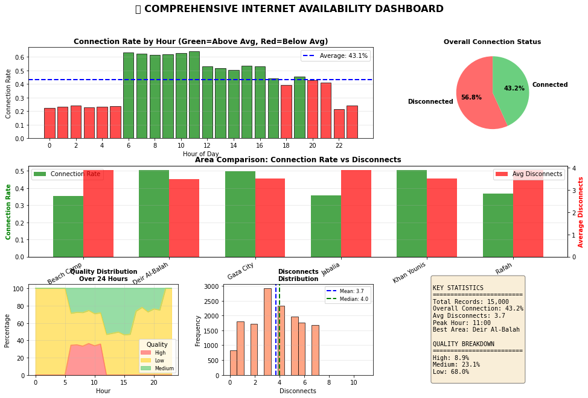
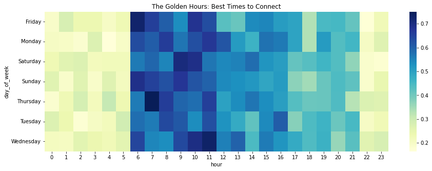
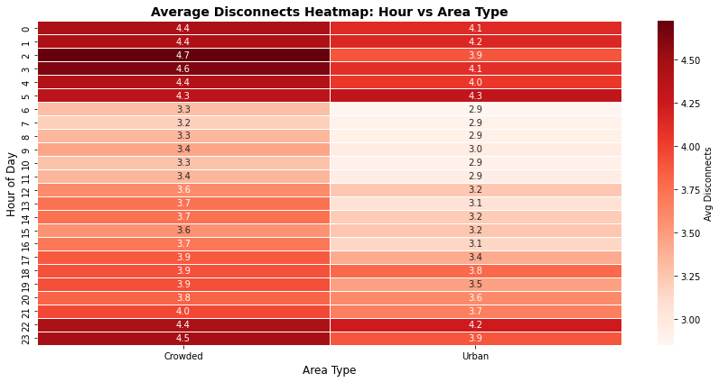
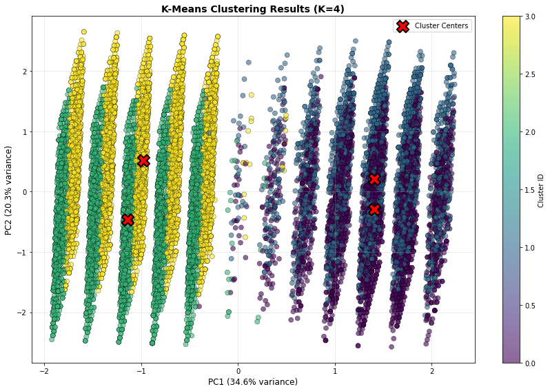
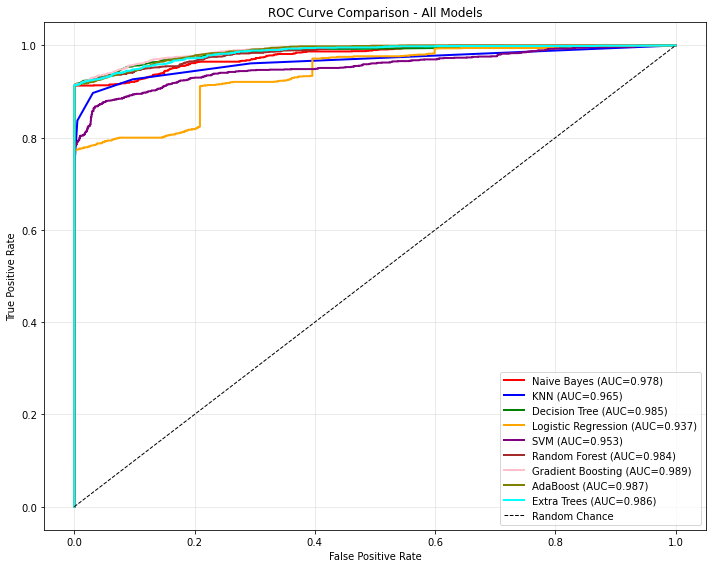

# 🌐 Internet Availability & Connectivity Pattern Discovery

[](https://www.python.org/)


Discovering **when and where connectivity fails** across 15,000 synthetic records. Combines descriptive statistics, `K-Means`/`PCA` pattern discovery, and classification.

## 📊 Statistical Snapshot

| Metric | Result |
|---|---:|
| Internet availability | 43.2% |
| Mean disconnects (95% CI) | 3.70 (3.666–3.731) |
| Disconnects: SD · Skewness · Kurtosis | 2.04 · 0.00 · −0.96 |

`K-Means` segments records into four connectivity patterns; `PCA` projects clusters for inspection. `Gradient Boosting` led the recorded classifier comparison (F1 **0.9545**).

> **Caveat:** Data is synthetic, and classification features include variables tied to the target-generation logic. Treat model scores as exploratory, not real-world predictive performance.

## 📈 Visualizations

**1. Connectivity overview** — availability by hour, area comparison, quality, and overall summary.



**2. Availability patterns by day and hour**



**3. Disconnect intensity by hour and area type**



**4. K-Means clusters projected with PCA**



**5. Classification performance across models**



## 🧰 Stack

`Pandas` · `NumPy` · `SciPy` · `Scikit-learn` · `Matplotlib` · `Seaborn`

## ▶️ Quick Start

```bash
python -m pip install pandas numpy scipy scikit-learn matplotlib seaborn jupyter
jupyter notebook Knowledge_Discovery_Final_Project.ipynb
```

Run all cells to generate the dataset and reproduce the analysis. Results may vary between runs.
"# gaza-internet-availability-analytics" 
